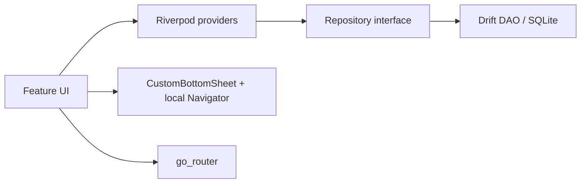

# Architecture and components

**Status:** Target architecture for Flutter implementation. No app code exists in this repository yet.

## Confirmed stack

| Layer | Choice | Notes |
|-------|--------|--------|
| SDK management | FVM | Pin Flutter version in repo when implementation starts |
| UI | Flutter (Material) | Semantic light/dark |
| State | Riverpod | Feature-scoped providers |
| Routing | go_router | App shell routes only |
| Persistence | Drift (SQLite) | Local V1 |
| PDF / share | `pdf`, `share_plus` (or equivalent) | Client/supplier statements |
| Media | `image_picker`, `path_provider` | Receipt photos |
| Formatting | `intl` | Dates, numbers; Arabic locale |
| Typography | Cairo | Arabic shaping in app |

## Confirmed high-level layout (feature-first)

```
lib/
  app/           # MaterialApp, theme, l10n, go_router shell
  core/          # DB, IDs, timestamps, money types, shared errors
  features/
    home/
    clients/     # Client + primary project UI (V1)
    vouchers/    # Receive / spend entry & lists
    suppliers/   # Directory + profiles + supplier statements
    items/       # Global item catalog & per-project stats
    statements/  # Client PDF / period UI
```

**Proposal:** Extract dedicated `project/` and `craftsman/` feature folders if client detail and agreement flows outgrow `clients/` — same public routes, clearer ownership.

## Layering (sync-ready, no sync in V1)

**Confirmed pattern:**

1. **Domain models** — immutable types, piastres integers, enums (receive/spend, materials/labor, cash/transfer).
2. **Repository interfaces** — async CRUD + queries; no SQL in widgets.
3. **Drift implementations** — single database file; workspace_id on all tenant rows.
4. **UI** — Consumer widgets; navigation via go_router; sheets use nested navigator (see [UX flows](ux-flows.md)).

No actual backend, auth, or sync scaffold in V1. Interfaces should allow a future `Remote*` implementation without rewriting UI.

## Routing vs bottom sheets

| Mechanism | Use |
|-----------|-----|
| go_router | Tab shell, full-screen lists (“See all”), profiles, statement preview |
| Nested `Navigator` inside `CustomBottomSheet` | Inline create flows only — **not** go_router |

## Module responsibilities

### `home`

- All-time totals for **active** projects only
- Active client balance list
- Quick access to suppliers/craftsmen directory
- Launch voucher with client/type context

### `clients`

- Client list and detail (acts as project UI for V1 initial project)
- Balance, totals, engineer % card, craftsman previews, top items, latest 5 movements
- Archive client/project

### `vouchers`

- Create/edit/delete transactions
- Contextual preselection from Home or client
- Photo attachment pipeline

### `suppliers`

- Combined directory UX with separate supplier vs craftsman lists and selectors
- Profiles and per-entity history
- Supplier statement (V1)

### `items`

- Global item CRUD (color, icon)
- Per-project material/labor stats (read models)

### `statements`

- Period picker, in-app statement, PDF generation, share sheet
- RTL table layout, grouped expenses — see [UX flows](ux-flows.md)

## Planned core services (not implemented)

- **IdGenerator** — UUID/v4 or similar, local uniqueness
- **Clock** — `createdAt`/`updatedAt`
- **BalanceProjector** — derives balances from transactions (recompute on edit/delete)
- **StatementBuilder** — period filter, grouping, PDF layout

## Diagram: request flow (V1)



## Cross-references

- [Data schema](data-schema.md) — tables and invariants
- [Shared components](shared-components.md) — UI contracts
- [Implementation plan](implementation-plan.md) — build order
