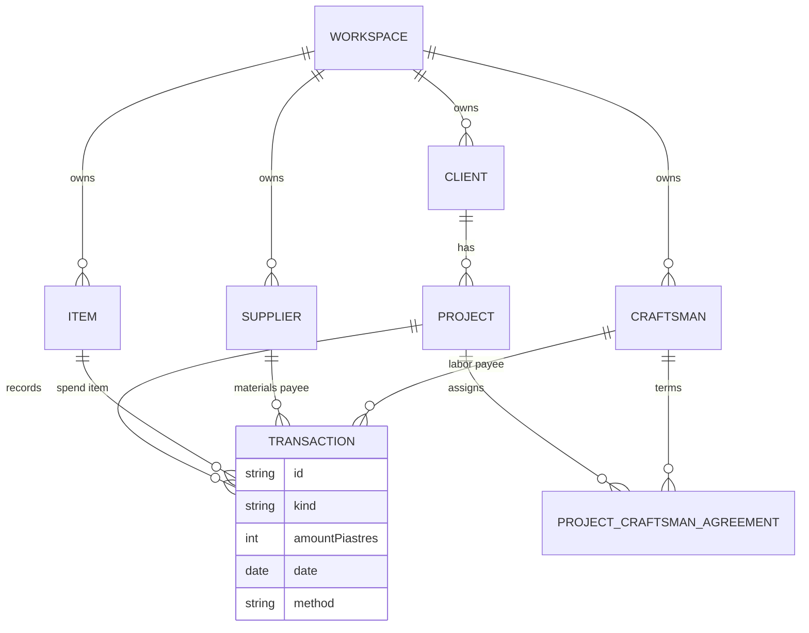

# Data schema and financial invariants

**Confirmed** field and relationship rules below unless marked **Open** or **Proposal**. Storage is SQLite via Drift in V1; names are logical.

All monetary amounts are **signed or unsigned integers in piastres** (1 EGP = 100 piastres). Never use `double` for money.

## Workspace

| Field | Type | Notes |
|-------|------|--------|
| id | string | Auto-created once; invisible in UI |
| createdAt, updatedAt | datetime | |

Every other entity carries `workspaceId` (or equivalent FK) and must reference rows in the same workspace.

## Entities

### Client

| Field | Type | Notes |
|-------|------|--------|
| id | string | Local unique |
| workspaceId | string | |
| name | string | |
| phone / contact | string? | |
| archivedAt | datetime? | Archive, not delete |
| createdAt, updatedAt | datetime | |

**Confirmed:** Creating a client auto-creates an initial **Project** (no user step).

### Project

| Field | Type | Notes |
|-------|------|--------|
| id | string | |
| workspaceId | string | |
| clientId | string | FK Client |
| name | string | |
| unitAddress | string? | |
| status | active \| archived | |
| engineerPercentage | decimal? | Optional; **Open:** precision/rounding |
| createdAt, updatedAt | datetime | |

### Item (workspace catalog)

| Field | Type | Notes |
|-------|------|--------|
| id, workspaceId | string | |
| name | string | |
| color, icon | string / enum | Accent + Material icon name |
| archivedAt | datetime? | |
| createdAt, updatedAt | datetime | |

### Supplier

| Field | Type | Notes |
|-------|------|--------|
| id, workspaceId | string | |
| name | string | |
| phone | string? | |
| notes | string? | |
| archivedAt | datetime? | |
| createdAt, updatedAt | datetime | |

### Craftsman

| Field | Type | Notes |
|-------|------|--------|
| id, workspaceId | string | |
| name, phone | string | |
| trade | string? | |
| notes | string? | |
| archivedAt | datetime? | |
| createdAt, updatedAt | datetime | |

Suppliers and craftsmen are **separate** tables; never a single “party” type in V1.

### ProjectCraftsmanAgreement

| Field | Type | Notes |
|-------|------|--------|
| id, workspaceId | string | |
| projectId, craftsmanId | string | |
| initialAmountPiastres | int? | **Null ≠ 0** — blank means no agreement row semantics for “remaining” |
| createdAt, updatedAt | datetime | |

**Confirmed:** Agreement is not an expenditure; paying craftsman uses labor **expense** transactions.

### Transaction

| Field | Type | Notes |
|-------|------|--------|
| id, workspaceId | string | |
| projectId | string | |
| kind | receive \| spend | |
| amountPiastres | int | Positive magnitude |
| date | date | |
| method | cash \| transfer | |
| description | string? | |
| receiptImagePath | string? | |
| itemId | string? | Spend only |
| expenseType | materials \| labor? | Spend only |
| supplierId | string? | Materials spend |
| craftsmanId | string? | Labor spend |
| createdAt, updatedAt | datetime | |

**Confirmed:** Receive rows omit expense fields. Labor spend requires craftsman; materials spend may reference supplier.

## ER diagram



## Financial invariants

### Project balance

**Confirmed:**

```
projectBalance = sum(receive.amount) - sum(spend.amount)
```

Transaction edits and deletes **must** update derived totals (recompute or incremental — implementation choice).

**Open:** Behavior when balance goes negative (not decided; do not silently forbid in domain layer without product sign-off).

### Home aggregates

**Confirmed:** All-time receipt/spend totals include **active projects only** (archived projects excluded). No “today” or “this month” KPIs in V1.

### Item totals (per project)

Derive from spend transactions with `itemId` set, split by `expenseType` (materials vs labor).

### Craftsman on project

**Confirmed:**

```
paidPiastres = sum(labor spend.amount where craftsmanId = X and projectId = P)
```

If `initialAmountPiastres` is **set** (non-null):

```
remainingPiastres = initialAmountPiastres - paidPiastres
```

If agreement amount is **absent** (null): show **paid only**; do not show remaining.

Agreement amount does not reduce project balance until paid via labor spend.

### Engineer estimated profit (informational)

**Confirmed:** When `engineerPercentage` is set:

```
estimatedProfit = totalProjectSpend * rate
```

Informational only — no balance deduction, no receivable line, excluded from default client PDF.

### Worked example (confirmed narrative)

| Step | Amount (EGP) |
|------|----------------|
| Received | 20,000 |
| Materials spend | 5,000 |
| Labor spend | 3,000 |
| **Project remaining** | **12,000** |

Craftsman agreement 8,000 → paid 3,000 → **owed 5,000** (agreement accounting only; 12,000 project remaining unchanged until additional labor payments).

## Archiving

**Confirmed:** Archiving Client, Project, Item, Supplier, or Craftsman sets `archivedAt`; entity hidden from pickers; historical transactions retain FKs for statements.

**Open:** Historical rename policy for statements/PDF after rename.

## Sync and deletion (V1 local)

**Confirmed:** Edit/delete transactions locally.

**Open:** Sync deletion semantics, conflict resolution, audit trail — see [Open questions](open-questions.md).

## Cross-references

- [Scope](scope.md) — V1 boundaries
- [UX flows](ux-flows.md) — voucher and statement behavior
- [Implementation plan](implementation-plan.md) — fixture IDs for acceptance tests
