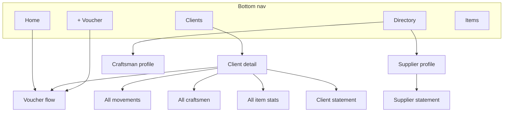

# UX and screen flows

**Confirmed** navigation and flows unless noted **Proposal** or **Open**.

## Primary navigation (floating pill + satellite)

**Confirmed (owner override, 2026-11):** Supersedes legacy index HTML **5-tab center FAB** and older “five slots” wording.

| Pill destination | Route purpose |
|------------------|---------------|
| **Home** | Totals, active clients, supplier quick access |
| **Clients** | Client list |
| **Directory** | Suppliers and craftsmen (separate lists; shared tab shell) |
| **Items** | Global catalog |

| Satellite | Purpose |
|-----------|---------|
| **+** (circular, beside pill end) | New voucher (contextual) — **not** a center tab slot |

**Open (product):** Exact satellite side (start vs end in RTL/LTR), pill width, and + diameter — implement only after owner picks or approves a mock.

**Confirmed:** No dedicated summary tab. Content scrolls behind dock; bottom gradient fade + scroll padding per [design.md](design.md).

**Reference:** [visual-reference.md](visual-reference.md) for non-nav UI; [ui-acceptance.md](ui-acceptance.md) for checklist.

## Home

- All-time receive/spend totals (**active projects only**)
- List of active clients with balances
- Shortcut into supplier/craftsman directory
- Actions to start voucher: choose client and transaction type; **reset stale voucher state** when launched from here

## Clients

### List

Active clients (archived hidden or filtered per design). Tap → client/project detail (V1 single primary project on client page).

### Client / project detail

| Section | Content |
|---------|---------|
| Header | Balance, receipt/spend totals |
| Engineer card | Compact; tap opens edit sheet (name/contact, unit, optional %,) |
| Craftsmen | Up to **3 previews**: paid / remaining per [Data schema](data-schema.md) rules |
| Expense breakdown | Top **3 items** with materials vs labor bars |
| Movements | Latest **5** transactions |
| Actions | Receive / spend; each “See all” → full list route |

Dedicated full lists: all movements, all craftsmen on project, all items stats, agreements.

## Directory (suppliers & craftsmen)

**Confirmed:** Separate list UIs and selectors; not merged into one “contact” picker.

- Profile per supplier/craftsman
- History of related transactions (supplier statement scope in V1)
- Craftsman: work broken down **per project**

## Items (global)

- CRUD name, color, icon
- Stats consumed on project detail (no global-only analytics tab required)

## Craftsman assignment

Sheet from project context:

- Pick from **global roster** (archived excluded)
- Optional per-project agreement amount (nullable — blank ≠ 0)

Craftsman labor spend selector shows craftsmen **assigned to project** (via agreements/assignments — same roster rules).

## Voucher (receive / spend)

### Context rules

| Entry point | Behavior |
|-------------|----------|
| Home + | User picks client and receive/spend; clear prior draft state |
| Client detail | Project and type preselected |
| Receive | Hide expense fields (item, materials/labor, supplier, craftsman) |
| Client change | Clear craftsman incompatible with new project roster |

### Spend

- **Segmented control:** Materials | Labor (not dropdown)
- Materials: optional supplier
- Labor: craftsman (from project assignments)
- Item required (spend)
- Method: cash | transfer only
- Optional description, receipt photo

### Presentation

- Incoming: **green** arrow / emphasis
- Outgoing: **red** arrow / emphasis
- List cells: amount, type, item, payee, date, description

### Edit / delete

Supported in V1 from movement lists; totals refresh ([Open](open-questions.md): audit).

## Inline create

When a picker lacks client, item, supplier, or craftsman:

1. Single **`CustomBottomSheet`** with nested local **`Navigator`**
2. **Never** stack another sheet or raw dialog on top
3. Preserve unfinished parent form state
4. Save → pop with new entity selected
5. Cancel → restore prior selection state
6. Android/iOS Back → pop inner route before dismiss

See [Shared components](shared-components.md).

## Statements

### Client

- In-app view + shareable PDF for **selected period**
- Header: client name, statement date, period label
- Summary: received, spent, remaining, material vs labor totals
- Expense movements **grouped by item**; under each item: material/labor subheaders; table columns (RTL): **No. | Amount | Description | Date**
- Receipts section **separate** — not duplicated under each item
- Engineer fee **not** on default PDF

**Open:** Period opening balance / carry-forward semantics — resolve before implementation ([Open questions](open-questions.md)).

### Supplier

Statement/history in V1 (in-app; PDF optional per implementation plan phase).

### PDF acceptance (qualitative)

Arabic fonts, shaping, RTL column order, sane page breaks, totals reconcile with in-app figures for same period.

## Screen map (simplified)

## Cross-references

- [Design](design.md) — colors and typography
- [Data schema](data-schema.md) — calculations
- [Implementation plan](implementation-plan.md) — phase acceptance
